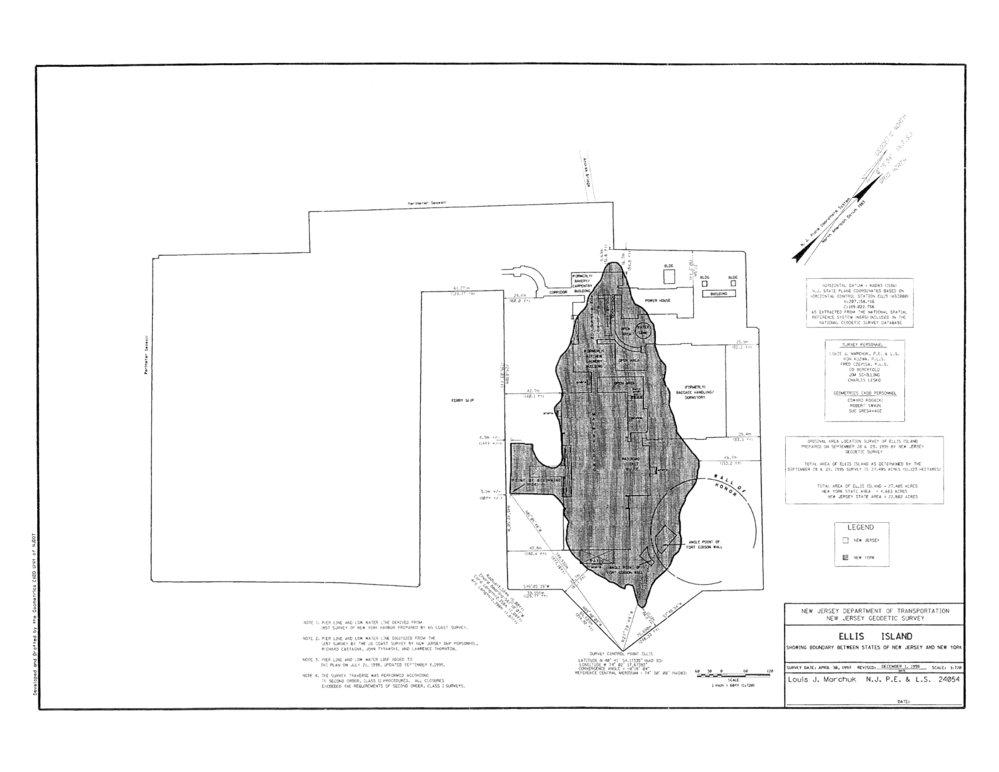

**Case and dockets:** New Jersey v. New York; No. 120, Original.
**Event and date:** original implementing decree, 1999-05-17; October Term 1998.
**Result:** Six-part boundary decree and map entered; retained jurisdiction and equal Special Master expenses; public tally undisclosed.
**Version / lineage:** Original adjudication; supersedes no completed event. Frozen handoffs identified below establish stage lineage. Repository verification and commitment remain with the operator.

## Event, participation and law entering implementation

The original action returns for an implementing decree under the May 26, 1998 judgment and recommittal. The supplied May 17, 1999 date schedules implementation. No new argument date is established. The adopted Engine §14 premise is ordinary presentation under the existing recommittal. The published instrument supplies a proposed geographic implementation, not proof of a new filing, State consent, service, default or prior entry. This reconstruction alters none of the completed merits.

All nine participate at submission and decision; no disqualification is established. Quorum is satisfied and five votes suffice. Research cutoff: May 17, 1999; common pre-date law excludes same-day peers. The [focused law](../entering-law/OT_1998CHUNK8_LAW_05_nj_ny.md) supplies the actual prior judgment: New Jersey's later federal fill; New York's original island to low water including the accepted 1834 filled pier once; no territorial exchange, automatic added pier acreage or acreage-driven line. No separate Standards and Tests provision changes that entitlement.

## Conformity and exact operative instrument

The six-part text and December 1, 1998 map implement those entitlements in one closed perimeter. Parts I–III preserve the Compact allocation and territorial injunction; Part IV supplies the NAD83 start and all 182 courses; Parts V–VI retain implementing jurisdiction and share the Master's compensation, assistance and litigation expenses equally. No concrete conflict with the actual mandate is identified. The map was visually inspected in assembly: the original island and pier appear once inside the retained outline, not as an added second parcel.

The [geometry receipt](../freeze/OT_1998CHUNK8_NJ_GEOMETRY.json) checks 182 consecutive courses, about 0.002154-foot closure and about 4.682723 planar acres from rounded printed values. These certify transcription consistency only, not a new survey, historical geographic finding or acreage award. Existing reliable work is authorized; absence of an operator resurvey supplies no reason for a fresh title trial.

The operative text below is copied directly from the saved source by script, without retyping or altering a course or qualification. The map attachment is byte-identical to the authorized source. They become the Court's entered instrument through this decision, not through historical publication.

## Stone compatibility and internal commitments

Stone expressly proposes this six-part instrument and December 1 map with the published start and 182 courses exactly, only insofar as they implement the actual prior judgment. Conformity review satisfies that condition. He supports all parts and the map without fallback, new ownership, substituted map or broader geographic premise.

O'Connor, Kennedy, Souter, Ginsburg and Breyer join the complete instrument. With Stone, six support entry. Stevens, Scalia and Thomas withhold territorial Parts I–IV on maintained prior prescription or Compact-construction grounds; they identify no implementing defect and have no independent objection to incidental retained jurisdiction or equal costs. This six-to-three internal support is not a new merits redetermination or a separate vote on incidental provisions. It remains undisclosed publicly.

## Form, assignment and publication

Form is fixed by the implementing task: an unsigned decree with the exact instrument and map, no fresh merits opinion or noted adherence statement. Repeating prior dissents requires no new public writing.

**Counted lead opinion:** No; unsigned original implementing decree.

No opinion assignment occurs, so there is no balance-pool selection or counted author. Prior authorship does not transfer. The public decree has no tally or individual lineup and does not imply unanimity. Internal commitments remain outside the Public Projection.

## Law, continuity, sources and validation

The decree gives geographic effect to the adjudicated entitlement without new doctrine or a private-title, tax, municipal-regulation, federal-administration, public-access or unpresented maritime ruling. The original action has an entered decree with retained jurisdiction, not an automatic return date. Prior-term separate positions remain prior positions; no new noncontrolling writing is published.

The [neutral validation](../freeze/OT_1998CHUNK8_NEUTRAL_VALIDATION.md), A model/reconciliation and geometry receipt supply bounded support. Assembly checked six-part scope, complete course sequence, exact text and map identity, six supporting participants and public nondisclosure. Source text was copied mechanically. The Record enters Current Term State when durably written; final chunk checks cover projections. Repository verification and commitment remain with the operator.

## Adaptive audit annex

### New Jersey v. New York — No. 120, Original

#### Proposed decree, existing mandate and alternatives

This is implementation of the May 26, 1998 judgment, not a second merits trial. The [six-part instrument](../sources/chunk8-neutral-control/NJ_PROPOSED_INSTRUMENT.txt) and [December 1, 1998 map](../sources/chunk8-neutral-control/NJ_BOUNDARY_MAP.png) were read in full as supplied. They are a bounded reconstructed proposal presented under the existing recommittal, not proof of historical filing, agreement, service, default or prior entry. Their ordinary presentation is the adopted minimum procedure from the neutral supplement.

Part I grants New Jersey the later federal fill and enjoins New York's enforcement or assertion of sovereignty there as located by the decree. Part II preserves Article First's sovereign line. Part III preserves the original 1834 island to low water and the historical filled pier. Part IV supplies one perimeter beginning at the specified NAD83 point and continuing through all 182 courses, with the map. Part V retains implementing jurisdiction; Part VI allocates the Master's compensation, assistance and litigation expenses equally. These provisions are considered together, without treating the decree's broad enforcement wording as an adjudication of every reserved municipal, property, federal or regulatory question.

The [geometry receipt](../freeze/OT_1998CHUNK8_NJ_GEOMETRY.json) verifies the consecutive course sequence and approximately 0.002154-foot closure, yielding approximately 4.682723 planar acres. Those checks demonstrate printed consistency only. The map depicts the pier within the single retained outline, not a second added parcel. The prior judgment rejected a mechanical additional 0.2-acre award and an acreage-driven exchange; no part of this instrument authorizes either. The textual entitlement and map, not computed acreage alone, provide conformity. The prior mandate permits use of existing reliable survey work and does not compel an independent new survey or trial.

**Path N1:** Enter the conforming instrument with its exact schedule and accompanying map, retaining only the stated implementation jurisdiction and cost provision. The strongest objection is that geometrical closure does not certify the actual historical line. That is true, but closure is not used as proof of title: the authenticated supplied description and map implement the previously adjudicated line, and the neutral validation establishes no concrete discrepancy requiring a new title premise. A different abstract acreage from an earlier approximation does not supply such a defect.

**Path N2:** Withhold entry pending identification and repair of a concrete conflict between the proposal and the existing mandate. This is lawful if an actual inconsistency is established; it fails on this packet because no duplicate pier parcel, administrative exchange, missing course or inconsistent entitlement is shown. A fresh historical-boundary trial solely because a modern operator has not resurveyed the island would contradict the prior permission to use supported existing work.

**Path N3:** Oppose the divided-island decree by adhering to the prior whole-island merits dissent, without inventing a technical defect or treating adherence as new evidence. This is a judicial dissent from implementing the maintained disputed entitlement, not a lawful lower-court disregard of the Court's mandate. It supplies no new majority disposition or independent authority to redraw the boundary.

#### Frozen Justice commitments

| Justice | Result and own date-eligible basis | Alternatives, exact join and limits |
|---|---|---|
| Stevens | N3. Oppose entry insofar as it implements divided sovereignty; adhere to his 1998 prescription dissent. He accepted the Compact's original allocation but found New York's cumulative sovereign practice sufficient for later acquisition of the fill. | Acknowledges that the proposal conforms to the Court's actual judgment and that no new survey defect is established. Does not join divided-island entry merely because he conditionally rejected exchange of a fixed boundary. His public statement may preserve the prior prescription ground without new merits findings or a demand for needless technical proceedings. |
| O'Connor | N1. Enter the complete conforming decree. Her full join in Souter's 1998 opinion supports the historical low-water line, once-counted filled pier and rejection of administrative reconfiguration. | N2 requires a concrete discrepancy, absent here. Joins the exact instrument, map, retained jurisdiction and equal cost allocation. No independent new acreage award or regulatory merits ruling. |
| Scalia | N3. Oppose the divided-island allocation while adhering to his 1998 Compact-construction dissent, joined there by Thomas. Practical construction supported the enlarged island as New York territory in his view; prescription was unnecessary. | Does not claim that geometry discloses a new defect or that approximate acreage authorizes a substitute. The existing mandate remains the Court's law. His adherence statement supplies only his previously published ground; no new historical practice or fact is added. |
| Kennedy | N1. Enter the complete conforming decree. His full 1998 join binds entitlement to the Compact boundary rather than convenience; the present instrument supplies the geographically complete implementation previously reserved. | N2's quality-control concern is answered at the actual record's scope, without treating arithmetic as an independent resurvey. Joins all six parts and map within the reserved substantive limits. |
| Souter | N1. Enter the complete conforming decree. His own 1998 opinion separates title, historical line, pier inclusion and accurate implementation. The single closed perimeter resolves the prior duplication concern without awarding land by an arithmetic target. | Neither N2 without a specific defect nor whole-island reargument alters the established mandate. Joins all six parts, including the specific sovereignty injunction, equal expenses and retained implementation jurisdiction; no unrelated merits reopening. |
| Thomas | N3. Adhere to his join in Scalia's 1998 whole-island Compact dissent and oppose the divided allocation's decree. | Does not convert the prior conditional objection to territorial exchange into a vote for actual divided-island entry. Accepts no fabricated new title or survey objection; the disagreement remains the prior Compact construction. |
| Ginsburg | N1. Her full 1998 join and join in Breyer's concurrence preserve the actual Compact allocation and the significance of federal administration without acquiring territory through equivocal acts. Enter the conforming instrument now supplied. | N2 is unwarranted absent an actual inconsistency. No renewed prescription ruling, assumed consent, separate pier acreage or universal view of Compact clarity. Joins all six parts and map. |
| Breyer | N1. His full 1998 join and concurrence distinguish actual allocation and notice from administrative convenience. Exact geographic implementation now follows that entitlement without another survey or title determination. | Closure and area are only checks. Reject N2's unnecessary delay absent a real defect, and preserve the prior reservations about federal control, private title and unpresented regulatory questions. Joins all six parts and map. |

**Compatibility and public functions:** O'Connor, Kennedy, Souter, Ginsburg and Breyer support entry in full. Stevens, Scalia and Thomas oppose insofar as the decree implements the territorial division, for the separate prior grounds stated. They identify no new implementing defect. Their adherence can be recorded in concise published statements rather than invented new merits opinions. No authorship is selected here. All three have no separate objection to equal allocation of the Master's costs or to retention of jurisdiction as an incident of whichever decree the Court enters; that absence of a distinct cost objection is not recounted as a separate adjudicative vote or as assent to divided sovereignty.

**Remedy and stage:** If the required Court majority adopts N1, the six-part decree, exact schedule and map become the geographic implementation of the prior judgment, with the stated injunction, retained jurisdiction and costs. The original action has an entered implementing decree but retains jurisdiction for its proper effect; no automatic later return is scheduled. The complete schedule must be copied mechanically from the authorized source into the eventual implementing record/attachment. This commitment does not itself enter the decree, copy or rewrite its coordinates, change title or close a docket.

**Genuine gaps:** No specific description conflict remains at the adopted neutral scope. The geometric receipt is not a cadastral survey certification. The Court does not decide municipal regulation, taxation, private title, federal monument administration, public access, damages, maritime questions beyond the Compact implementation, or later reclamation. Reconstruction supplies routine presentation only, never State consent or default.

### New Jersey v. New York — No. 120, Original

#### Implementing action and source status

The proposed six-part decree implements the May 26, 1998 judgment. It fixes New Jersey's later artificial fill and New York's original island to the 1834 low-water line including the accepted historical filled pier once, using the December 1, 1998 map and complete 182-course NAD83 perimeter. It retains implementation jurisdiction and divides the Master's compensation, assistance and litigation expenses equally. It neither awards a separately added 0.2-acre parcel nor substitutes an acreage-driven territorial exchange. Arithmetic closure and approximately 4.682723 planar acres check printed consistency; they do not independently prove the historical survey or award acreage.

The source supplies a bounded reconstructed proposed instrument under Engine §14, not proof of an actual filing, consent, default or prior entry. Neutral validation found no concrete conflict with the existing mandate. Existing reliable survey work is permitted; absence of a new operator survey supplies no ground to require a fresh title trial. The full exact instrument and map must be copied mechanically from the authorized proposal in assembly, never reconstructed by retyping.

#### Eight reconciled internal dispositions

| Associate | Internal disposition and exact instrument joins | Individual basis and comparator limit |
|---|---|---|
| Stevens | Withholds entry of territorial Parts I–IV insofar as they implement divided sovereignty; no independent objection to incidental Parts V–VI | Maintains his published 1998 prescription ground for New York's enlarged-island title. Acknowledges conformity to the Court's actual judgment and no new survey defect. Historical decree discloses no individual vote with which to compare this internal view. |
| O'Connor | Enter; complete Parts I–VI and map join | Her full 1998 join supports the original boundary, pier counted once and faithful implementation. No concrete discrepancy warrants withholding the decree. Historical entry is compatible but supplies no personal vote. |
| Scalia | Withholds territorial Parts I–IV; no independent objection to incidental Parts V–VI | Maintains his 1998 practical-Compact-construction ground, without prescription or a new technical objection. The prior rejection of exchanging a fixed boundary does not make him join divided ownership. No historical individual decree vote is supplied. |
| Kennedy | Enter; complete Parts I–VI and map join | His 1998 join binds implementation to the Compact boundary. The now-complete single perimeter supplies the implementation previously reserved; closure is not treated as an independent resurvey. |
| Souter | Enter; complete Parts I–VI and map join | His 1998 opinion separates title, historical line and accurate implementation. The proposal follows that mandate without an acreage target, duplicated pier or unrelated merits reopening. No historical authorship transfers. |
| Thomas | Withholds territorial Parts I–IV; no independent objection to incidental Parts V–VI | Adheres to his 1998 join in Scalia's Compact construction. No new fact or survey objection is inferred; the Court's actual mandate remains governing law. |
| Ginsburg | Enter; complete Parts I–VI and map join | Her full 1998 join and Breyer-concurrence join support actual Compact allocation despite federal administration. No new prescription finding, consent or separate pier acreage is supplied. |
| Breyer | Enter; complete Parts I–VI and map join | His full 1998 join and concurrence preserve allocation, notice and administrative limits. The supported description implements that entitlement without a new title trial or general regulatory ruling. |

These are private implementation commitments, not a new public merits poll. The historical decree contains no new merits tally, authorship or noted dissents. Silence cannot establish unanimity, a personal vote or abandonment of a prior view. Nor does the old dissent alone require a new published adherence statement. The public form is an unsigned implementing decree without count or lineup; no new noted statement is selected merely to repeat the already published 1998 disagreement. Incidental cost/jurisdiction positions are not recounted as a separate adjudicative vote or as assent to territorial division.

The existing five Associate full-instrument joins support entry, subject to the ordinary final assembly. The three maintained allocation objections identify no present implementing defect and require no new technical proceedings. No material historical vote departure can be certified where no individual historical decree vote is disclosed; the instrument and legal implementation are consistent with the verified historical decree at the bounded reconstructed scope.

**Remedy and stage:** If adopted, enter the complete conforming instrument and map, with its sovereignty injunction, retained implementation jurisdiction and equal expenses. The original action then has an entered geographic decree with retained jurisdiction, not an automatic later return. Municipal regulation, taxation, private title, federal monument administration, public access, damages and unpresented maritime questions remain outside this implementation.

**Readiness:** Reconciled for an unsigned implementing decree. No specific source or description conflict blocks entry at the authorized scope. Exact schedule copying and final conformity verification remain assembly tasks.

## Public Projection

## Event

New Jersey v. New York, No. 120, Original. Implementing decree, May 17, 1999. The Court considers the geographic instrument implementing its May 26, 1998 judgment concerning sovereignty over Ellis Island. No new argument date is stated. This proceeding implements the settled Compact entitlement and resolves the decree's geographic form.

## Participation

The Court acts in its original jurisdiction. No individual vote or lineup is announced for the decree.

## Public Action

The Court enters the following six-part decree and its December 1, 1998 map.

```text
I
The State of New Jersey’s prayer that she be declared to
be sovereign over the landfilled portions of Ellis Island
added by the Federal Government after 1834 is granted and
the State of New York is enjoined from enforcing her laws
or asserting sovereignty over the portions of Ellis Island
that lie within the State of New Jersey’s sovereign boundary
as set forth in paragraph 4 of this decree.
II
The sovereign boundary between the State of New Jersey
and the State of New York is as set forth in Article First of
the Compact of 1834, enacted into law in both States and
approved by Congress.
III
The State of New York remains sovereign under Article
Second of the Compact of 1834 of and over the original Ellis
Island, to the low-water mark, and the pier area built on
landfill, as the Island and pier were structured in 1834, as
more particularly depicted on the 1857 United States Coast
Survey of New York Harbor.
IV
The boundary between the two States on Ellis Island is
as depicted on the map of Ellis Island, Showing Boundary
Between States of New Jersey and New York, dated Decem-
ber 1, 1998, which is appended hereto, infra.
The boundary
between the two States, as depicted on the appended map,
lies along the line described as follows:
Beginning at a point with North American Datum of 1983
(NAD83) metric coordinates of North 207 180.7849 (latitude
North 40 degrees 41 minutes 54.92285 seconds) and East 188
879.9657 (longitude West 74 degrees 02 minutes 23.75137
seconds), said point being (a) South 45 degrees 42 minutes
50 seconds East along the northeasterly granite block wall
of the Ferry Slip about 502 feet from the northwesterly ter-
minus of said wall and thence being (b) North 46 degrees
39 minutes 35.7 seconds East about 10 feet to said point of
beginning; thence the following courses and distances:
(1) N 42 degrees 10 minutes 59.1 seconds W, a distance of
61.150 feet to a point; thence
(2) N 45 degrees 24 minutes 54.6 seconds W, a distance of
60.990 feet to a point; thence
(3) N 46 degrees 23 minutes 49.9 seconds W, a distance of
1.813 feet to a point; thence
(4) N 45 degrees 33 minutes 03.3 seconds E, a distance of
9.193 feet to a point; thence
(5) N 45 degrees 42 minutes 35.4 seconds E, a distance of
24.972 feet to a point; thence
(6) S 42 degrees 23 minutes 50.8 seconds E, a distance of
1.947 feet to a point; thence
(7) N 45 degrees 15 minutes 54.9 seconds E, a distance of
19.092 feet to a point; thence
(8) S 46 degrees 25 minutes 55.5 seconds E, a distance of
14.147 feet to a point; thence
(9) S 69 degrees 37 minutes 24.8 seconds E, a distance of
4.667 feet to a point; thence
(10) S 67 degrees 54 minutes 46.2 seconds E, a distance of
4.654 feet to a point; thence
(11) S 70 degrees 49 minutes 58.4 seconds E, a distance of
12.373 feet to a point; thence
(12) S 79 degrees 45 minutes 36.8 seconds E, a distance of
9.844 feet to a point; thence
(13) N 86 degrees 16 minutes 07.0 seconds E, a distance of
11.526 feet to a point; thence
(14) N 72 degrees 30 minutes 15.3 seconds E, a distance of
12.058 feet to a point; thence
(15) N 61 degrees 34 minutes 34.0 seconds E, a distance of
13.787 feet to a point; thence
(16) N 37 degrees 42 minutes 57.5 seconds E, a distance of
11.851 feet to a point; thence
(17) N 01 degrees 43 minutes 14.9 seconds E, a distance of
14.569 feet to a point; thence
(18) N 22 degrees 53 minutes 06.4 seconds W, a distance
of 13.500 feet to a point; thence
(19) N 48 degrees 57 minutes 00.8 seconds W, a distance
of 17.321 feet to a point; thence
(20) N 48 degrees 15 minutes 36.6 seconds W, a distance
of 13.988 feet to a point; thence
(21) N 51 degrees 26 minutes 12.9 seconds W, a distance
of 17.345 feet to a point; thence
(22) N 43 degrees 49 minutes 22.3 seconds W, a distance
of 12.907 feet to a point; thence
(23) N 54 degrees 54 minutes 43.1 seconds W, a distance
of 30.552 feet to a point; thence
(24) N 70 degrees 20 minutes 46.2 seconds W, a distance
of 26.016 feet to a point; thence
(25) N 49 degrees 23 minutes 55.3 seconds W, a distance
of 10.372 feet to a point; thence
(26) N 05 degrees 34 minutes 48.6 seconds W, a distance
of 10.927 feet to a point; thence
(27) N 00 degrees 17 minutes 59.9 seconds W, a distance
of 11.938 feet to a point; thence
(28) N 23 degrees 17 minutes 40.4 seconds W, a distance
of 14.698 feet to a point; thence
(29) N 53 degrees 00 minutes 04.3 seconds W, a distance
of 11.113 feet to a point; thence
(30) N 57 degrees 55 minutes 46.1 seconds W, a distance
of 11.654 feet to a point; thence
(31) N 63 degrees 34 minutes 20.5 seconds W, a distance
of 11.655 feet to a point; thence
(32) N 70 degrees 09 minutes 45.4 seconds W, a distance
of 10.498 feet to a point; thence
(33) N 64 degrees 39 minutes 53.0 seconds W, a distance
of 15.628 feet to a point; thence
(34) N 42 degrees 57 minutes 16.5 seconds W, a distance
of 9.906 feet to a point; thence
(35) N 20 degrees 46 minutes 20.1 seconds W, a distance
of 9.693 feet to a point; thence
(36) N 24 degrees 35 minutes 59.2 seconds W, a distance
of 11.411 feet to a point; thence
(37) N 18 degrees 46 minutes 40.9 seconds W, a distance
of 9.902 feet to a point; thence
(38) N 00 degrees 00 minutes 00.0 seconds E, a distance
of 12.938 feet to a point; thence
(39) N 05 degrees 54 minutes 22.1 seconds W, a distance
of 10.933 feet to a point; thence
(40) N 16 degrees 33 minutes 01.3 seconds W, a distance
of 13.823 feet to a point; thence
(41) N 33 degrees 24 minutes 44.2 seconds W, a distance
of 14.301 feet to a point; thence
(42) N 25 degrees 46 minutes 09.6 seconds W, a distance
of 12.076 feet to a point; thence
(43) N 37 degrees 08 minutes 48.1 seconds W, a distance
of 10.350 feet to a point; thence
(44) N 32 degrees 03 minutes 52.4 seconds W, a distance
of 12.833 feet to a point; thence
(45) N 31 degrees 19 minutes 03.9 seconds W, a distance
of 12.144 feet to a point; thence
(46) N 17 degrees 53 minutes 21.4 seconds W, a distance
of 10.377 feet to a point; thence
(47) N 06 degrees 53 minutes 43.1 seconds W, a distance
of 13.535 feet to a point; thence
(48) N 03 degrees 03 minutes 10.4 seconds E, a distance
of 9.388 feet to a point; thence
(49) N 11 degrees 29 minutes 11.7 seconds W, a distance
of 11.926 feet to a point; thence
(50) N 34 degrees 52 minutes 31.2 seconds W, a distance
of 10.056 feet to a point; thence
(51) N 30 degrees 47 minutes 02.9 seconds W, a distance
of 10.258 feet to a point; thence
(52) N 17 degrees 53 minutes 21.4 seconds W, a distance
of 10.377 feet to a point; thence
(53) N 00 degrees 21 minutes 53.8 seconds W, a distance
of 9.813 feet to a point; thence
(54) N 18 degrees 34 minutes 20.5 seconds W, a distance
of 8.242 feet to a point; thence
(55) N 06 degrees 10 minutes 47.7 seconds W, a distance
of 9.870 feet to a point; thence
(56) N 04 degrees 25 minutes 03.0 seconds W, a distance
of 14.606 feet to a point; thence
(57) N 21 degrees 57 minutes 38.0 seconds W, a distance
of 8.356 feet to a point; thence
(58) N 28 degrees 19 minutes 29.9 seconds W, a distance
of 10.011 feet to a point; thence
(59) N 23 degrees 19 minutes 03.8 seconds W, a distance
of 3.947 feet to a point; thence
(60) N 24 degrees 12 minutes 42.3 seconds W, a distance
of 10.211 feet to a point; thence
(61) N 09 degrees 17 minutes 00.8 seconds W, a distance
of 13.173 feet to a point; thence
(62) N 26 degrees 15 minutes 31.2 seconds E, a distance of
10.454 feet to a point; thence
(63) N 48 degrees 14 minutes 50.4 seconds E, a distance of
12.483 feet to a point; thence
(64) S 87 degrees 53 minutes 19.2 seconds E, a distance of
13.572 feet to a point; thence
(65) S 64 degrees 54 minutes 13.5 seconds E, a distance of
10.905 feet to a point; thence
(66) S 68 degrees 55 minutes 21.0 seconds E, a distance of
12.861 feet to a point; thence
(67) S 70 degrees 10 minutes 04.3 seconds E, a distance of
12.159 feet to a point; thence
(68) S 59 degrees 59 minutes 42.3 seconds E, a distance of
10.248 feet to a point; thence
(69) S 65 degrees 02 minutes 32.3 seconds E, a distance of
10.961 feet to a point; thence
(70) S 56 degrees 22 minutes 33.9 seconds E, a distance of
15.011 feet to a point; thence
(71) S 65 degrees 01 minutes 07.5 seconds E, a distance of
12.135 feet to a point; thence
(72) S 72 degrees 23 minutes 43.3 seconds E, a distance of
13.639 feet to a point; thence
(73) N 72 degrees 50 minutes 17.1 seconds E, a distance of
13.344 feet to a point; thence
(74) N 77 degrees 08 minutes 45.2 seconds E, a distance of
9.552 feet to a point; thence
(75) S 86 degrees 40 minutes 12.7 seconds E, a distance of
17.217 feet to a point; thence
(76) S 66 degrees 15 minutes 01.8 seconds E, a distance of
10.242 feet to a point; thence
(77) S 71 degrees 54 minutes 34.2 seconds E, a distance of
9.863 feet to a point; thence
(78) S 87 degrees 15 minutes 26.6 seconds E, a distance of
10.449 feet to a point; thence
(79) S 54 degrees 29 minutes 54.5 seconds E, a distance of
11.516 feet to a point; thence
(80) S 57 degrees 20 minutes 20.7 seconds E, a distance of
8.686 feet to a point; thence
(81) S 47 degrees 36 minutes 48.0 seconds E, a distance of
10.662 feet to a point; thence
(82) S 43 degrees 13 minutes 26.2 seconds E, a distance of
11.407 feet to a point; thence
(83) S 45 degrees 24 minutes 22.8 seconds E, a distance of
12.463 feet to a point; thence
(84) S 63 degrees 26 minutes 05.8 seconds E, a distance of
10.482 feet to a point; thence
(85) S 63 degrees 56 minutes 07.2 seconds E, a distance of
12.802 feet to a point; thence
(86) S 68 degrees 51 minutes 36.6 seconds E, a distance of
10.051 feet to a point; thence
(87) S 83 degrees 55 minutes 39.2 seconds E, a distance of
11.816 feet to a point; thence
(88) S 87 degrees 14 minutes 27.2 seconds E, a distance of
10.387 feet to a point; thence
(89) S 47 degrees 05 minutes 24.6 seconds E, a distance of
12.117 feet to a point; thence
(90) S 33 degrees 17 minutes 23.9 seconds E, a distance of
12.412 feet to a point; thence
(91) S 36 degrees 11 minutes 13.6 seconds E, a distance of
11.538 feet to a point; thence
(92) S 62 degrees 43 minutes 23.7 seconds E, a distance of
13.501 feet to a point; thence
(93) S 84 degrees 13 minutes 03.4 seconds E, a distance of
9.926 feet to a point; thence
(94) S 71 degrees 39 minutes 48.0 seconds E, a distance of
11.523 feet to a point; thence
(95) S 45 degrees 21 minutes 45.5 seconds E, a distance of
13.966 feet to a point; thence
(96) S 37 degrees 11 minutes 27.6 seconds E, a distance of
15.613 feet to a point; thence
(97) S 63 degrees 45 minutes 09.6 seconds E, a distance of
15.122 feet to a point; thence
(98) S 70 degrees 24 minutes 57.6 seconds E, a distance of
13.798 feet to a point; thence
(99) S 59 degrees 24 minutes 14.4 seconds E, a distance of
16.700 feet to a point; thence
(100) S 60 degrees 38 minutes 32.1 seconds E, a distance
of 13.768 feet to a point; thence
(101) S 48 degrees 52 minutes 16.5 seconds E, a distance
of 11.782 feet to a point; thence
(102) S 80 degrees 54 minutes 35.0 seconds E, a distance
of 12.659 feet to a point; thence
(103) S 83 degrees 25 minutes 05.0 seconds E, a distance
of 13.086 feet to a point; thence
(104) S 79 degrees 49 minutes 56.0 seconds E, a distance
of 11.683 feet to a point; thence
(105) S 85 degrees 36 minutes 04.7 seconds E, a distance
of 13.038 feet to a point; thence
(106) S 81 degrees 54 minutes 20.0 seconds E, a distance
of 14.204 feet to a point; thence
(107) N 90 degrees 00 minutes 00.0 seconds E, a distance
of 9.375 feet to a point; thence
(108) S 80 degrees 20 minutes 42.1 seconds E, a distance
of 15.279 feet to a point; thence
(109) S 47 degrees 58 minutes 47.4 seconds E, a distance
of 16.153 feet to a point; thence
(110) S 23 degrees 55 minutes 21.0 seconds E, a distance
of 9.094 feet to a point; thence
(111) S 38 degrees 34 minutes 09.6 seconds E, a distance
of 18.546 feet to a point; thence
(112) S 30 degrees 17 minutes 47.2 seconds E, a distance
of 12.885 feet to a point; thence
(113) S 13 degrees 08 minutes 27.9 seconds E, a distance
of 16.494 feet to a point; thence
(114) S 05 degrees 16 minutes 03.7 seconds E, a distance
of 17.700 feet to a point; thence
(115) S 17 degrees 09 minutes 57.4 seconds E, a distance
of 12.494 feet to a point; thence
(116) S 45 degrees 00 minutes 00.0 seconds E, a distance
of 4.419 feet to a point; thence
(117) S 18 degrees 43 minutes 50.9 seconds E, a distance
of 11.483 feet to a point; thence
(118) S 15 degrees 34 minutes 21.2 seconds E, a distance
of 11.873 feet to a point; thence
(119) S 28 degrees 42 minutes 40.4 seconds E, a distance
of 14.181 feet to a point; thence
(120) S 41 degrees 33 minutes 09.4 seconds E, a distance
of 11.024 feet to a point; thence
(121) S 56 degrees 56 minutes 54.8 seconds E, a distance
of 10.887 feet to a point; thence
(122) S 45 degrees 24 minutes 12.5 seconds E, a distance
of 12.551 feet to a point; thence
(123) S 42 degrees 16 minutes 25.3 seconds E, a distance
of 13.937 feet to a point; thence
(124) S 59 degrees 20 minutes 23.7 seconds E, a distance
of 12.134 feet to a point; thence
(125) S 46 degrees 10 minutes 08.9 seconds E, a distance
of 10.830 feet to a point; thence
(126) S 34 degrees 45 minutes 21.3 seconds E, a distance
of 11.183 feet to a point; thence
(127) S 21 degrees 48 minutes 05.1 seconds E, a distance
of 12.453 feet to a point; thence
(128) S 04 degrees 31 minutes 35.3 seconds W, a distance
of 15.047 feet to a point; thence
(129) S 23 degrees 00 minutes 39.1 seconds E, a distance
of 22.544 feet to a point; thence
(130) S 09 degrees 43 minutes 39.3 seconds E, a distance
of 13.317 feet to a point; thence
(131) S 02 degrees 45 minutes 32.8 seconds W, a distance
of 20.774 feet to a point; thence
(132) S 02 degrees 54 minutes 27.9 seconds W, a distance
of 19.713 feet to a point; thence
(133) S 11 degrees 36 minutes 10.4 seconds E, a distance
of 16.780 feet to a point; thence
(134) S 24 degrees 37 minutes 24.8 seconds E, a distance
of 13.200 feet to a point; thence
(135) S 27 degrees 06 minutes 38.6 seconds E, a distance
of 14.675 feet to a point; thence
(136) S 23 degrees 53 minutes 42.6 seconds E, a distance
of 10.801 feet to a point; thence
(137) S 39 degrees 13 minutes 03.4 seconds E, a distance
of 7.018 feet to a point; thence
(138) S 18 degrees 39 minutes 13.1 seconds E, a distance
of 10.357 feet to a point; thence
(139) S 09 degrees 11 minutes 48.0 seconds W, a distance
of 6.648 feet to a point; thence
(140) S 78 degrees 18 minutes 38.3 seconds W, a distance
of 5.553 feet to a point; thence
(141) S 89 degrees 32 minutes 03.1 seconds W, a distance
of 7.688 feet to a point; thence
(142) N 58 degrees 58 minutes 45.6 seconds W, a distance
of 10.794 feet to a point; thence
(143) N 61 degrees 57 minutes 19.1 seconds W, a distance
of 7.577 feet to a point; thence
(144) N 62 degrees 20 minutes 12.3 seconds W, a distance
of 8.750 feet to a point; thence
(145) N 60 degrees 15 minutes 18.4 seconds W, a distance
of 7.054 feet to a point; thence
(146) N 60 degrees 42 minutes 51.3 seconds W, a distance
of 13.544 feet to a point; thence
(147) S 65 degrees 42 minutes 51.0 seconds W, a distance
of 11.245 feet to a point; thence
(148) S 32 degrees 24 minutes 24.0 seconds W, a distance
of 8.513 feet to a point; thence
(149) S 36 degrees 24 minutes 59.0 seconds E, a distance
of 9.475 feet to a point; thence
(150) S 67 degrees 50 minutes 01.2 seconds W, a distance
of 5.467 feet to a point; thence
(151) S 66 degrees 40 minutes 56.2 seconds W, a distance
of 3.947 feet to a point; thence
(152) S 73 degrees 02 minutes 40.9 seconds W, a distance
of 5.358 feet to a point; thence
(153) S 82 degrees 11 minutes 37.0 seconds W, a distance
of 7.822 feet to a point; thence
(154) S 75 degrees 34 minutes 45.2 seconds W, a distance
of 9.035 feet to a point; thence
(155) S 54 degrees 44 minutes 03.2 seconds W, a distance
of 10.717 feet to a point; thence
(156) S 87 degrees 27 minutes 47.7 seconds W, a distance
of 9.885 feet to a point; thence
(157) S 71 degrees 24 minutes 08.2 seconds W, a distance
of 13.914 feet to a point; thence
(158) S 71 degrees 06 minutes 50.1 seconds W, a distance
of 15.061 feet to a point; thence
(159) S 83 degrees 21 minutes 17.0 seconds W, a distance
of 12.962 feet to a point; thence
(160) S 65 degrees 16 minutes 21.7 seconds W, a distance
of 10.459 feet to a point; thence
(161) S 87 degrees 31 minutes 20.6 seconds W, a distance
of 13.012 feet to a point; thence
(162) N 86 degrees 13 minutes 02.5 seconds W, a distance
of 15.158 feet to a point; thence
(163) S 83 degrees 50 minutes 33.1 seconds W, a distance
of 15.150 feet to a point; thence
(164) N 86 degrees 04 minutes 18.1 seconds W, a distance
of 14.597 feet to a point; thence
(165) N 73 degrees 38 minutes 51.4 seconds W, a distance
of 10.878 feet to a point; thence
(166) N 71 degrees 39 minutes 48.0 seconds W, a distance
of 11.523 feet to a point; thence
(167) N 60 degrees 04 minutes 59.0 seconds W, a distance
of 12.907 feet to a point; thence
(168) N 36 degrees 49 minutes 18.7 seconds W, a distance
of 14.912 feet to a point; thence
(169) N 44 degrees 13 minutes 20.2 seconds W, a distance
of 9.768 feet to a point; thence
(170) N 36 degrees 01 minutes 38.5 seconds W, a distance
of 11.051 feet to a point; thence
(171) N 21 degrees 30 minutes 05.2 seconds W, a distance
of 8.867 feet to a point; thence
(172) N 77 degrees 42 minutes 17.0 seconds W, a distance
of 9.979 feet to a point; thence
(173) N 84 degrees 45 minutes 45.1 seconds W, a distance
of 7.531 feet to a point; thence
(174) N 61 degrees 55 minutes 39.0 seconds W, a distance
of 9.563 feet to a point; thence
(175) N 29 degrees 24 minutes 45.0 seconds W, a distance
of 10.690 feet to a point; thence
(176) N 80 degrees 08 minutes 03.1 seconds W, a distance
of 5.836 feet to a point; thence
(177) N 72 degrees 52 minutes 01.2 seconds W, a distance
of 8.698 feet to a point; thence
(178) N 85 degrees 37 minutes 20.1 seconds W, a distance
of 13.101 feet to a point; thence
(179) S 88 degrees 52 minutes 55.8 seconds W, a distance
of 12.815 feet to a point; thence
(180) N 90 degrees 00 minutes 00.0 seconds W, a distance
of 4.313 feet to a point; thence
(181) S 49 degrees 21 minutes 03.9 seconds W, a distance
of 8.155 feet to a point; thence
(182) S 46 degrees 39 minutes 35.7 seconds W, a distance
of 99.169 feet to the point and place of beginning.
V
The Court retains jurisdiction to entertain such further
proceedings, enter such orders, and issue such writs as may
from time to time be considered necessary or desirable to
give proper force and effect to this Decree or to effectuate
the rights of the parties.
VI
The States of New Jersey and New York shall share
equally in the compensation for the Special Master and his
assistants, and for expenses of this litigation incurred by the
Special Master in this controversy.
```



## Judgment & Remedy

The conforming implementing decree is entered. It establishes the described boundary, enjoins New York from enforcing its laws or asserting sovereignty over territory assigned to New Jersey within the decree's defined scope, retains implementing jurisdiction, and divides the Special Master's compensation, assistance and litigation expenses equally. No numerical tally or individual lineup is announced.

## Opinion Topology

Unsigned decree of the Court. No signed opinion or new noted adherence statement accompanies it.

## Holdings

#### Geographic implementation of the existing judgment

**Operative rule:** The six-part instrument and incorporated map fix the interstate boundary under the prior judgment: New Jersey retains the later artificial fill, and New York retains the original island to its 1834 low-water line, including the accepted historical filled pier once. The complete perimeter controls; neither approximate acreage nor a separately added pier parcel replaces it.

**Authority:** The Court's implementing decree gives effect to the May 26, 1998 judgment. It discloses no individual vote or lineup.

**Controlling explanation:** The Court holds the description consistent with the entitlement already adjudicated. New Jersey v. New York supplies the Compact allocation and requires accurate implementation rather than an administratively convenient territorial exchange. One perimeter incorporates the original island and historical pier without double counting. The description and map implement that line without reopening prescription or awarding land by an acreage target. Retained jurisdiction permits proceedings needed to give the decree proper force and effect; it does not decide unrelated municipal regulation, taxation, private title, federal monument administration, public access, damages or later reclamation.

## Precedent Treatment

New Jersey v. New York, decided May 26, 1998, is implemented without changing its Compact construction, territorial entitlement, rejected exchange or reserved questions.

## Law After Decision

The adjudicated entitlement now has an entered geographic decree and enforceable implementing directions. No new constitutional rule or broader ownership, taxation or regulatory holding is announced.

## Separate Writings


## Procedure After Action

The decree takes effect as the Court's implementing disposition. The Court retains jurisdiction for proceedings, orders and writs needed to give it proper force and effect and effectuate the parties' rights. The States share the stated Special Master expenses equally. No return date is set.

## Source Notes

The complete geographic description and December 1, 1998 map appear in the [official United States Reports, volume 526, pages 589–601 and accompanying map](https://www.supremecourt.gov/opinions/boundvolumes/526bv.pdf). They are incorporated above; approximate acreage is not an independent territorial award.
